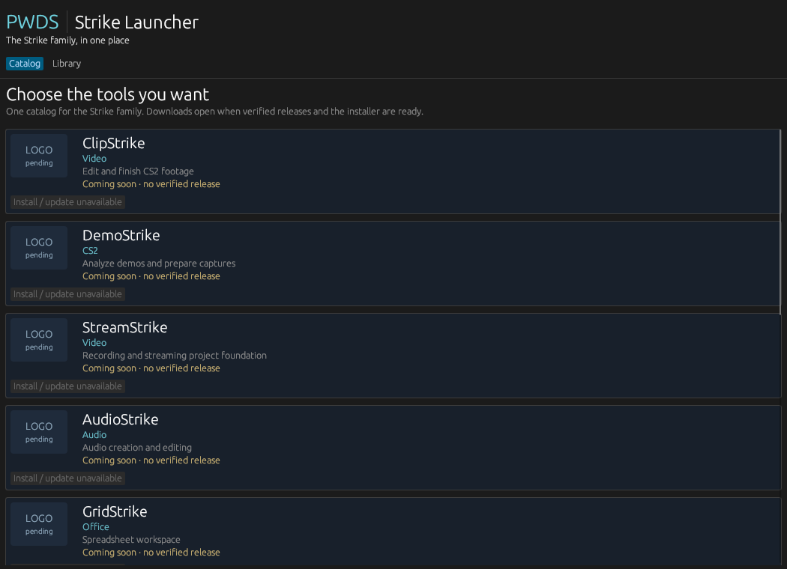
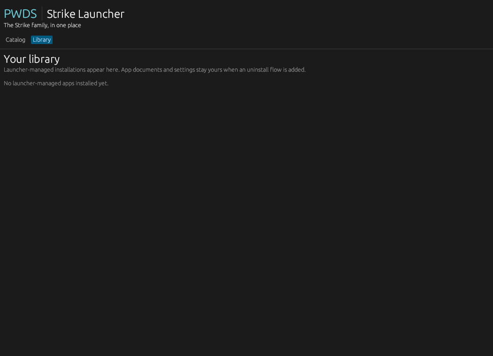

# PWDS Strike Launcher

<p align="center">
  <a href="https://prowebdevsolutions.com"><picture>
    <source media="(prefers-color-scheme: dark)" srcset="assets/branding/PWDS-logo-orange.svg">
    
  </picture></a>
</p>

**The Strike apps in one place.**

The launcher brings the Strike family into a single catalog. Browse each app's purpose and release status, and see a library designed to track verified installations when packaged releases exist.

## Native UI preview

These are inspected captures of the real Rust/egui launcher window from [draft PR #1](https://github.com/Gerbzz/PWDS-Strike-Launcher/pull/1), source commit [`bde73be`](https://github.com/Gerbzz/PWDS-Strike-Launcher/commit/bde73be12529557619ac8abf5cf98e1a2595dc32). They were taken on a Linux virtual display with software OpenGL. The draft includes a catalog layout fix that has not been merged into `main`; these images show that draft build, not a current downloadable release.





The bundled release manifest and capture runner's installed state were empty. The catalog shows unavailable installation controls, and the library shows no launcher-managed apps. See the [capture provenance](docs/screenshots/README.md) for the build run and file hashes.

## Highlights

- Browse app cards with purpose and release status.
- Check each app's current development and release status.
- Read the same catalog from the native UI or CLI.

## Current status

Source foundation, not a downloadable launcher. The release manifest is empty, so all apps currently show as coming soon. There is no download, install, launch, update, or uninstall executor; those controls remain disabled.

## Browse the catalog

The native Rust UI source has a catalog and library. Each card shows an app's name, purpose, release status, and a **Logo pending** slot where no approved asset is embedded. The CLI reads the same catalog and installed-state model:

```text
pwds-strike-launcher catalog
pwds-strike-launcher library
pwds-strike-launcher plan clipstrike
```

`plan` currently reports that there is no verified platform release. Install, launch, update, and uninstall controls are disabled until verified artifacts and executors exist.

## Release readiness

Current entries are source or development builds, with no accepted clean-machine installer or verified CI release artifact. The catalog is a product list, not a release claim: a source link or local prototype shortcut never enables installation. The embedded release manifest is empty; stable app IDs remain unprefixed for future library-state compatibility. See [installation design](docs/INSTALL_DESIGN.md) for the planned verified-artifact contract.

## Current implementation

- A single typed app catalog and versioned installed-state format are shared by CLI and UI. The state reader validates schema, IDs, versions, target, paths, and a 1 MiB input bound. It reads `installed.json` from the platform's local app-state location if present; the launcher does not create or mutate it yet.
- A release manifest is embedded in the binary. Only that bundled origin can produce a `TrustedManifest`. Release validation checks app/repository identity, platform, architecture, numeric version, HTTPS GitHub release URL, pinned SHA-256 and byte length, and a safe relative entrypoint. Planning chooses a newer matching release only.
- `verify_artifact` streams a file through SHA-256 and checks its exact pinned byte count before any future extraction. It does not download or activate the file.
- All catalog entries show “Coming soon” unless a real release is embedded. The library shows only validated launcher receipts. Buttons are disabled because no executor exists.

## Verification and limits

Source formatting and offline Cargo metadata checks passed. The draft capture source built on a standard hosted Windows runner, and its native catalog and library were captured and visually reviewed on a hosted Linux runner. Clean-machine installation remains outstanding. These captures do not verify the planned install or update flow.

The next functional milestone is one properly licensed and packaged Windows release with a pinned artifact, a bounded downloader and safe ZIP extraction into same-volume staging, atomic activation and recovery, then a clean-machine install/update/uninstall test. User documents and settings must stay outside versioned app directories and remain after uninstall by default.

## PWDS brand artwork

The company mark in this masthead is the existing [official PWDS logo](https://github.com/Gerbzz/PWDS-Website/blob/main/public/prowebdevsolutions-logo.png), with the [official orange display asset](https://prowebdevsolutions.com/images/prowebdevsolutions-logo-orange.svg) for dark backgrounds. Any app logo above it remains the original Strike suite artwork.
