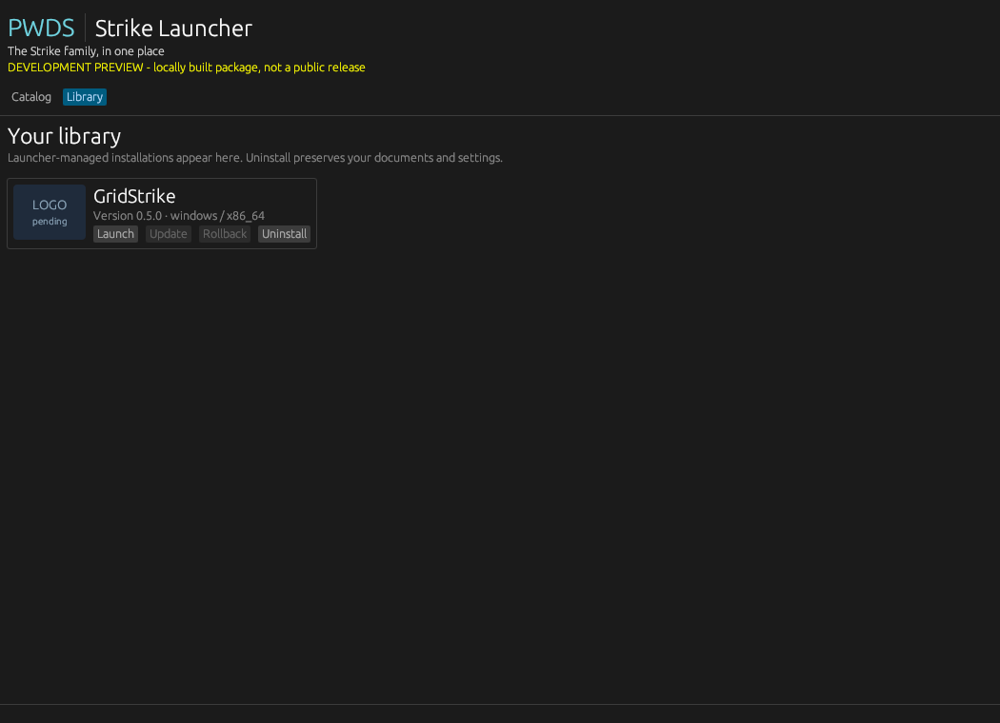
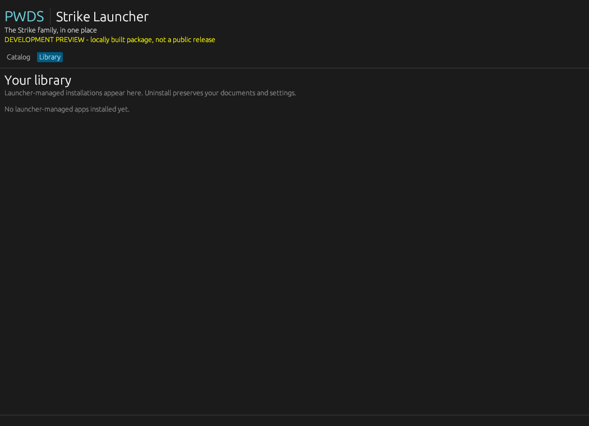

# PWDS Strike Launcher

<p align="center">
  <a href="https://prowebdevsolutions.com"><picture>
    <source media="(prefers-color-scheme: dark)" srcset="assets/branding/PWDS-logo-orange.svg">
    
  </picture></a>
</p>

**The Strike apps in one place.**

The launcher brings the Strike family into a single catalog. Browse each app's purpose and release status, then install, launch, update, roll back, or uninstall a pinned release when one is available.

## Native UI preview

These are inspected captures of the real Rust/egui launcher window from [merged PR #1](https://github.com/Gerbzz/PWDS-Strike-Launcher/pull/1), source commit [`bde73be`](https://github.com/Gerbzz/PWDS-Strike-Launcher/commit/bde73be12529557619ac8abf5cf98e1a2595dc32). They were taken on a Linux virtual display with software OpenGL. These images are development previews, not a downloadable release.


The bundled release manifest and capture runner's installed state were empty. The catalog shows unavailable installation controls, and the library shows no launcher-managed apps. See the [capture provenance](docs/screenshots/README.md) for the build run and file hashes.

### Installer development preview

The current Rust installer was also exercised with a real GridStrike 0.5.0 package built on a [standard Windows runner](https://github.com/Gerbzz/PWDS-Strike-Launcher/actions/runs/38778010775). These fresh native Office PC captures show the isolated development-preview library before and after uninstall. They do not represent a public release.





See the [installer capture provenance](docs/screenshots/README.md#installer-development-preview) for the exact package hash, source commit, and test boundary.
The [synthetic update](docs/screenshots/installer-gridstrike-preview-synthetic-update.png)
and [rollback](docs/screenshots/installer-gridstrike-preview-rolled-back.png)
states were also captured on the Office PC with the prebuilt native launcher;
their [provenance and limits](docs/screenshots/README.md#fresh-update-and-rollback-capture-2026-10-16)
are recorded separately.

## Highlights

- Browse app cards with purpose and release status.
- Check each app's current development and release status.
- Read the same catalog from the native UI or CLI.

## Current status

Installer development preview, not a downloadable public launcher. The embedded release manifest is still empty, so no public Strike app installation is enabled. The Rust executor and native controls are wired for future reviewed releases, and an isolated GridStrike package can be exercised with the opt-in `developer-preview` feature.

## Browse the catalog

The native Rust UI source has a catalog and library. Each card shows an app's name, purpose, release status, and a **Logo pending** slot where no approved asset is embedded. The CLI reads the same catalog and installed-state model:

```text
pwds-strike-launcher catalog
pwds-strike-launcher library
pwds-strike-launcher plan clipstrike
```

`plan` currently reports that there is no verified platform release. Install and update remain disabled until a reviewed artifact is pinned in `releases.json`. Launcher-owned installations show Launch, Rollback, and Uninstall controls after receipt and file verification.

## Release readiness

Current entries are source or development builds, with no accepted clean-machine installer or verified public release artifact. The catalog is a product list, not a release claim: a source link or local prototype shortcut never enables public installation. The embedded release manifest is empty; stable app IDs remain unprefixed for library-state compatibility. See [installation design](docs/INSTALL_DESIGN.md) for the verified-artifact contract.

## Current implementation

- A single typed app catalog and versioned installed-state format are shared by CLI and UI. Receipts include a SHA-256 inventory for every installed file; older receipts without inventory cannot authorize launch or uninstall.
- A release manifest is embedded in the binary. Only that bundled origin can produce a `TrustedManifest`. Release validation checks app/repository identity, platform, architecture, numeric version, HTTPS GitHub release URL, pinned SHA-256 and byte length, and a safe relative entrypoint. Planning chooses a newer matching release only.
- The executor downloads only embedded release URLs, checks GitHub asset redirects, applies size and SHA-256 pins, rejects unsafe ZIP entries, and extracts into a same-volume staging directory. It keeps the prior version during update and can recover an interrupted receipt swap or roll back to the previous verified version.
- Launch uses the verified entrypoint directly. Uninstall removes only inventoried version directories and preserves user documents and settings. Native operations run in a worker thread with phase/byte progress, cancellation before activation, and error reporting.
- All catalog entries show "Coming soon" while the release manifest is empty. The `developer-preview` feature permits an explicit local GridStrike package and isolated install root for CI testing; it is not included in the default build.

## Verification and limits

The installer integration tests use synthetic archives and isolated roots for corruption, traversal, cancellation, interrupted receipt swap, existing install, update, rollback, and uninstall. The `installer-development-preview.yml` workflow builds GridStrike from a pinned source commit on a standard Windows runner, packages it as a clearly labeled development preview, exercises install/launch/uninstall in an isolated runner root, and captures the native library. Its run artifact is evidence for that preview only.

Before enabling a public release, verify the uploaded asset bytes independently, complete its license/runtime notice audit, determine publisher signing policy and minimum OS, and repeat the workflow on a clean machine. User documents and settings must remain outside versioned app directories.

## PWDS brand artwork

The company mark in this masthead is the existing [official PWDS logo](https://github.com/Gerbzz/PWDS-Website/blob/main/public/prowebdevsolutions-logo.png), with the [official orange display asset](https://prowebdevsolutions.com/images/prowebdevsolutions-logo-orange.svg) for dark backgrounds. Any app logo above it remains the original Strike suite artwork.
